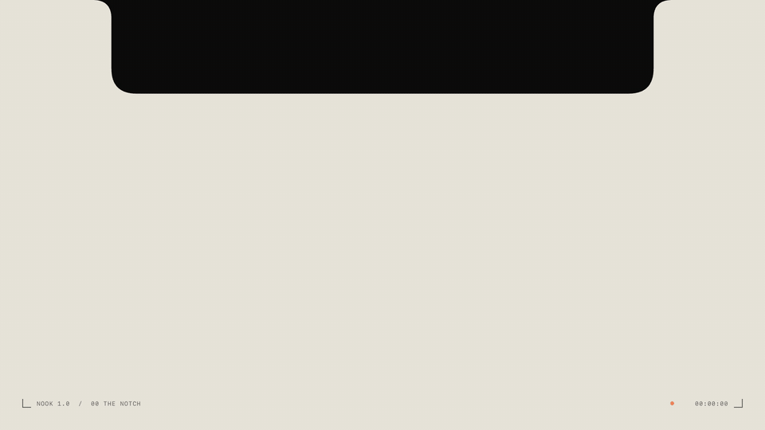

# Nook

**Your MacBook's notch, put to work.** Point at the notch (or press **⌥⌘N**) and a dark glass panel unfolds with three tools: a file Shelf, a private AI assistant, and Spotify controls.


<p align="center">
  
</p>
<p align="center"><a href="https://github.com/Neelabho/nook/raw/main/docs/media/nook-demo.mp4"><b>Download the video with sound</b></a> (30 s, MP4, 7.4 MB)</p>

| | |
|---|---|
| **Shelf** | A holding area for files, folders, text and notes. Drag things in from anywhere, drag them out where they belong. Nook keeps its own verified copy, never touches the original, and anything you remove stays recoverable for 7 days. |
| **Assistant** | Chat with a local model (Qwen 3 8B or any model you have) through [Ollama]. Streaming, stop, Markdown, code copy, one-click actions like *Explain*, *Shorten* and *Review code*. **Nothing leaves your Mac.** |
| **Music** | Spotify controls with album art, a spinning vinyl, and an optional in-notch catalogue search. While a song plays, the closed notch shows the cover and a live waveform. |

Native Swift 6 · SwiftUI + AppKit · App Sandbox · hardened runtime · no third-party dependencies · no telemetry · no account.

---

## Why Nook

- **Private by design.** The assistant accepts loopback addresses only and refuses cloud models. Artwork is fetched over HTTPS from Spotify's CDN only. There are no analytics, crash reporters or update pings.
- **Safe with your files.** Every Shelf import is copied, checked with SHA-256 and committed atomically. A crash, a full disk or a corrupt index never costs you an item ([how it works](docs/ARCHITECTURE.md#shelf-data-safety-model)).
- **Light on battery.** Hover detection uses tracking areas, not polling. Measured at idle: about 0 % CPU, under 2 wake-ups/s, ~14 MB of memory.
- **Feels like part of macOS.** It opens without stealing focus, uses Liquid Glass on macOS 26, and respects Reduce Motion, Reduce Transparency and Increase Contrast.

## Requirements

- An **Apple silicon** Mac with a notch running **macOS 15 or later** (Liquid Glass styling on macOS 26+). Macs without a notch get a slim strip at the top of the screen instead.
- Optional: [Ollama] with a local model for the Assistant (`ollama pull qwen3:8b`).
- Optional: the Spotify desktop app for Music.
- To build from source: **Xcode 26** or the matching **Command Line Tools** (Swift 6.2 or newer).

## Download

1. Download **Nook-1.0.0.zip** from the [latest release](https://github.com/Neelabho/nook/releases/latest).
2. Unzip it and drag **Nook.app** into **Applications**.
3. Open Nook. Because this build isn't notarized by Apple yet, macOS blocks the first launch. Go to **System Settings › Privacy & Security**, scroll down to the message about Nook, click **Open Anyway** and confirm. You only need to do this once.
4. Nook appears in the menu bar. Point at the notch or press **⌥⌘N**.

Prefer to check what you're running? Every release lists the zip's SHA-256 so you can verify it with `shasum -a 256 Nook-1.0.0.zip`, or build it yourself from source below.

## Install from source

```bash
git clone https://github.com/Neelabho/nook.git
cd nook
scripts/test.sh                                      # run the test suite (works without Xcode)
NOOK_ALLOW_LOOPBACK_SIGNIN=1 scripts/build-app.sh    # → build/Nook.app (release, sandboxed, ad-hoc signed)
scripts/install.sh                                   # → ~/Applications/Nook.app (backs up any existing copy first)
```

- `scripts/install.sh --system` installs to `/Applications` instead.
- `NOOK_ALLOW_LOOPBACK_SIGNIN=1` adds the short-lived 127.0.0.1 listener needed for Spotify catalogue search. Leave it out if you don't need search. Default builds then open no listening sockets.
- To sign with your own Developer ID: `NOOK_SIGN_IDENTITY="Developer ID Application: …" scripts/build-app.sh`.
- To work in Xcode, open `Package.swift`.

Run the built-in self-test (it runs inside the real sandbox with temporary data only):

```bash
~/Applications/Nook.app/Contents/MacOS/Nook --self-test
```

### First run

1. Nook runs as a menu bar app with no Dock icon. The closed notch looks unchanged because Nook draws pure black exactly over the camera housing.
2. Rest the pointer on the notch for about 0.1 s to open it, or press **⌥⌘N**, or use the menu bar icon.
3. **Open at login** is registered on the first launch from `~/Applications` or `/Applications`. If macOS asks, approve it in *System Settings › General › Login Items*. You can turn it off in *Nook Settings › General*.
4. **Music**: open Spotify, then click **Connect to Spotify** in the Music tab. macOS asks once whether Nook may control Spotify.
5. **Assistant**: start Ollama (the Ollama app or `ollama serve`). Nook prefers `qwen3:8b` when it's installed and never downloads models itself.

## Using Nook

**Opening and closing**: hover over the notch, press ⌥⌘N, or use the menu bar icon. The panel closes when the pointer leaves (after the close delay), when you press Esc, or when you click elsewhere. **Pin open** keeps it open. **Larger panel** switches to a bigger view. ⌘1/⌘2/⌘3 switch tabs.

**Shelf**
- *Add*: drag files, folders, text or images onto the notch; it opens as a drop target. You can also use **+** (file picker), the clipboard button or ⌘V, or **New Note**. Nook always stores its **own copy**; the original is never moved or modified.
- *Get things out*: drag a tile to Finder, the Desktop or any app that accepts files. Text items drop as text; hold ⌥ when you start dragging to drop a `.txt` file instead. ⌘-click or ⇧-click selects several items.
- *Explicit transfer*: right-click a tile for **Save a Copy As…**, **Move To…**, Copy, Quick Look, Show in Finder or Remove. Space opens Quick Look, Delete removes, ←/→ move the selection.
- *After a drag-out*, an item is hidden **only if the destination reported that it accepted the drop**, and stays recoverable under *More Shelf actions (…) › Recently Removed* for 7 days by default.

**Assistant**: type a question, or paste text and choose Explain, Improve, Shorten, Friendlier, More formal, Summarize, Review code, Explain error or Format code. Replies stream in; **Stop generating** (or ⌘.) stops one. Every reply has **Copy** and **To Shelf** buttons. **Prompt scratchpad** holds prompts you reuse. When a model is in memory, the header shows its size and **Unload** frees it immediately.

**Music**: play/pause, previous/next, seek and volume. The record spins only while Spotify is playing, and not at all with Reduce Motion on.

**Now playing on the closed notch**: while Spotify plays, the closed notch widens to show the album cover on the left and moving waves on the right, for 2 minutes after the panel closes and whenever the track changes. Turn it off in *Settings › Music › Closed notch*.

**Search Spotify**: click the magnifying glass in the Music tab, or press ⌘F.
- *Without setup:* **Search in Spotify app** opens Spotify's own search for your text.
- *In-Nook results* (optional, uses your own free Spotify developer app):
  1. Create an app at [developer.spotify.com/dashboard](https://developer.spotify.com/dashboard). Spotify requires the **app owner to have Premium** for development-mode apps.
  2. Add the redirect URI shown in Settings: `http://127.0.0.1:43828/nook-callback` (or `…:43827/…` for the staging build).
  3. Paste the app's Client ID in *Settings › Music › Catalogue search*, then Sign In.

  Sign-in uses PKCE, so no client secret is needed or stored. Tokens live in your Keychain. The only scope requested is `user-modify-playback-state`, so a chosen result can start inside its album.

## Privacy

Nook makes exactly these network connections, and nothing else:

| Destination | When |
|---|---|
| Your Ollama server on `127.0.0.1` / `::1` / `localhost` | Only when the Assistant is open or you send a message |
| Spotify's image CDN (`*.scdn.co`, `*.spotifycdn.com`, HTTPS only) | Album art, only while the Music view or now-playing peek is shown. Can be turned off. |
| `accounts.spotify.com` and `api.spotify.com` | Only if you set up catalogue search and sign in |

Everything Nook stores (Shelf items, conversation history, settings) stays in its sandbox container on your Mac. *Settings › Privacy* lists it, and the diagnostics log is kept in memory only, with file paths redacted.

## Uninstall

```bash
scripts/uninstall.sh      # moves the app to the Trash; never deletes Shelf data
```

The script prints where your Shelf files are. Copy out anything you want to keep, then delete the data container in Finder if you want everything gone.

## Documentation

- [Architecture](docs/ARCHITECTURE.md): modules, the data-safety model, the interaction state machine, and platform decisions
- [Testing](docs/TESTING.md): automated suites, the sandboxed self-test, and the manual checklist
- [Troubleshooting](docs/TROUBLESHOOTING.md): Ollama, Spotify, drag and drop, permissions and login items
- [Status](docs/STATUS.md): what's done, known limitations, and ideas for what's next

## Contributing

Bug reports, ideas and pull requests are welcome. Start with [CONTRIBUTING.md](CONTRIBUTING.md). To report a security problem, please follow [SECURITY.md](SECURITY.md) instead of opening a public issue.

## License

[MIT](LICENSE). Nook is not affiliated with or endorsed by Apple, Spotify or Ollama.

[Ollama]: https://ollama.com
